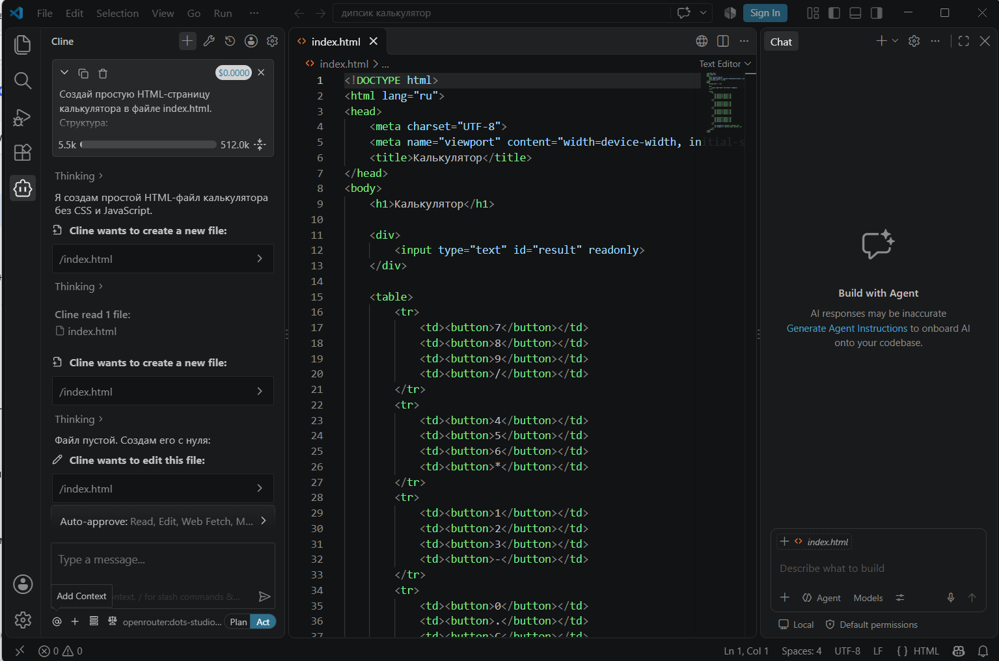
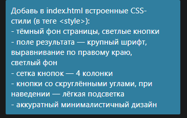
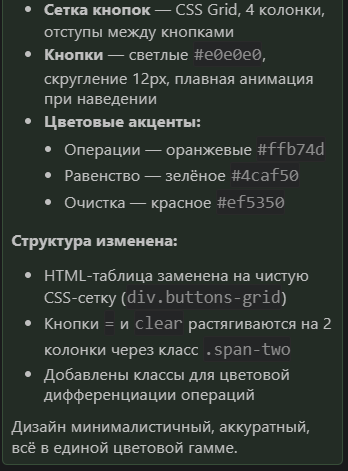
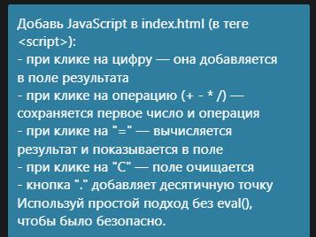
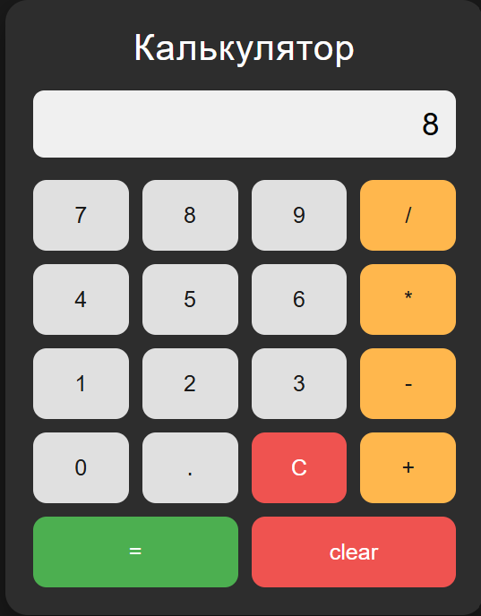

# Домашнее задание: Сравнительный анализ AI-инструментов

## 1. Задача и требования

**Задача:** Создать простой калькулятор на HTML/CSS/JS.

| Требование | Ответ |
|---|---|
| Сложность | Низкая: одностраничное приложение |
| Доступ к локальным файлам | Да, код пишем локально в VS Code |
| Безопасность данных | Низкая (учебный проект, нет пользовательских данных) |
| Бюджет | Бесплатно (OpenRouter, бесплатная модель) |

## 2. Сравнительная таблица инструментов

| Критерий | Bolt.new | Lovable | Codex | Cline |
|---|---|---|---|---|
| Доступ к контексту проекта | 3 | 3 | 4 | 5 |
| Скорость генерации | 5 | 5 | 4 | 4 |
| Качество кода | 3 | 4 | 4 | 4 |
| Стоимость | 3 | 3 | 4 | 5 |
| Безопасность данных | 2 | 2 | 3 | 4 |
| Удобство интеграции | 5 | 5 | 3 | 4 |
| **Средний балл** | **3.5** | **3.7** | **3.7** | **4.3** |

## 3. Обоснование выбора

Выбран **Cline** по следующим причинам:
- Работает прямо в VS Code с локальными файлами
- Бесплатный, оплата только за API (в нашем случае — 0 ₽ через OpenRouter)
- Официальная поддержка DeepSeek
- Удобно давать задачи пошагово и сразу видеть результат

**Альтернативы:**
- **Bolt.new, Lovable** — облачные, код не у пользователя, для учебного проекта избыточны
- **Codex** — хорош, но требует больше настройки под локальную модель

## 4. Настройка окружения

1. Установлен VS Code
2. Установлено расширение Cline из маркетплейса
3. Зарегистрирован аккаунт на OpenRouter
4. Создан API-ключ на OpenRouter
5. В Cline выбран провайдер OpenRouter и вставлен ключ
6. Выбрана бесплатная модель DeepSeek

## 5. Практическое применение

Создан калькулятор за 3 промпта:

**Промпт 1 (HTML):** «Создай простую HTML-страницу калькулятора...»
**Результат:** Cline создал файл index.html с базовой разметкой. 

**Промпт 2 (CSS):** «Добавь в index.html встроенные CSS-стили...»
**Результат:** Добавлены стили, тёмный фон, сетка кнопок.  

**Промпт 3 (JS):** «Добавь JavaScript... без eval()...»
**Результат:** Рабочая логика калькулятора. 

**Сложности:** не возникло, все промпты отработали с первого раза.
### Финальный результат

## 6. Выводы

Cline показал себя удобным инструментом для небольших задач: работает локально, редактирует файлы напрямую, легко подключается к бесплатным моделям через OpenRouter. Для калькулятора хватило 3 промптов. Альтернативы (Bolt.new, Lovable) генерируют быстрее, но код остаётся в облаке, что не подходит при работе с приватными проектами.