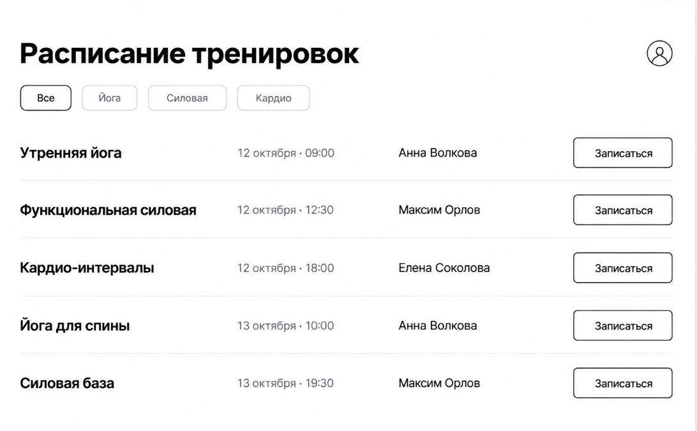
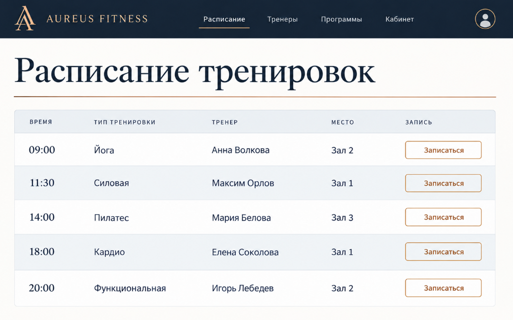

# UI-концепции фитнес-клуба

Для проекта сгенерированы 3 визуальные концепции интерфейса в ChatGPT (DALL-E) — как аналог Text-to-UI инструментов (GalileoAI, v0.dev).

---

## Концепция 1. Минималистичная

**Особенности дизайна:**
- Белый фон, чёрный текст
- Тонкие серые разделители
- Фильтры-таблетки с обводкой
- Кнопки «Записаться» без заливки
- Много свободного пространства, шрифт без засечек

**Преимущества:**
- Легко читается, не перегружает пользователя
- Быстро разрабатывается
- Хорошо масштабируется на мобильные

**Недостатки:**
- Выглядит сдержанно, не передаёт «энергию» фитнеса
- Может казаться скучным для молодой аудитории

---

## Концепция 2. Яркая / энергичная

**Особенности дизайна:**
- Бренд «ИМПУЛЬС» с ярким логотипом
- Оранжево-красные градиенты, чёрные акценты
- Крупные заголовки, жирные шрифты
- Карточки тренировок в сетке 3 в ряд
- Иконки: лотос, гантель, сердце, огонь

**Преимущества:**
- Передаёт спортивную энергию, мотивирует
- Хорошо запоминается, яркий бренд
- Отлично смотрится на мобильных и десктопе
- Карточки легко листать и сравнивать

**Недостатки:**
- Может утомлять при долгом использовании
- Требует качественной работы с цветами и контрастом
- Не подходит для «премиальной» аудитории

---

## Концепция 3. Корпоративная / премиум

**Особенности дизайна:**
- Бренд «AUREUS FITNESS»
- Тёмно-синяя палитра, золотые акценты
- Шрифты с засечками в заголовках
- Табличная компоновка расписания
- Строгая сетка, ровные отступы

**Преимущества:**
- Выглядит дорого и респектабельно
- Подходит для премиум-сегмента
- Удобная таблица — хорошо для планирования
- Вызывает доверие у взрослой аудитории

**Недостатки:**
- Менее эмоциональный, чем яркая концепция
- Не подходит для молодой активной аудитории
- Сложнее в реализации (шрифты, цвета)

---

## Обоснование выбора

**Выбрана концепция 2 — яркая / энергичная («ИМПУЛЬС»).**

**Причины:**
1. **Соответствие аудитории.** Целевая аудитория (18–45 лет, хотят заниматься фитнесом) лучше откликается на яркий энергичный дизайн, чем на минимализм или премиум.
2. **Мотивация.** Фитнес — это про движение и энергию. Концепция передаёт эти эмоции через цвета и крупные формы.
3. **Функциональность.** Карточки тренировок в сетке удобно листать и сравнивать — лучше, чем таблица (концепция 3) и список (концепция 1).
4. **Запоминаемость.** Яркий бренд «ИМПУЛЬС» с логотипом и градиентами легче запоминается, что важно для привлечения новых клиентов.
5. **Универсальность.** Концепция хорошо адаптируется под мобильные — карточки легко перестраиваются в одну колонку.

**Альтернативы:**
- Концепция 1 (минимализм) — слишком сдержанна для фитнес-тематики
- Концепция 3 (премиум) — не соответствует массовой аудитории проекта