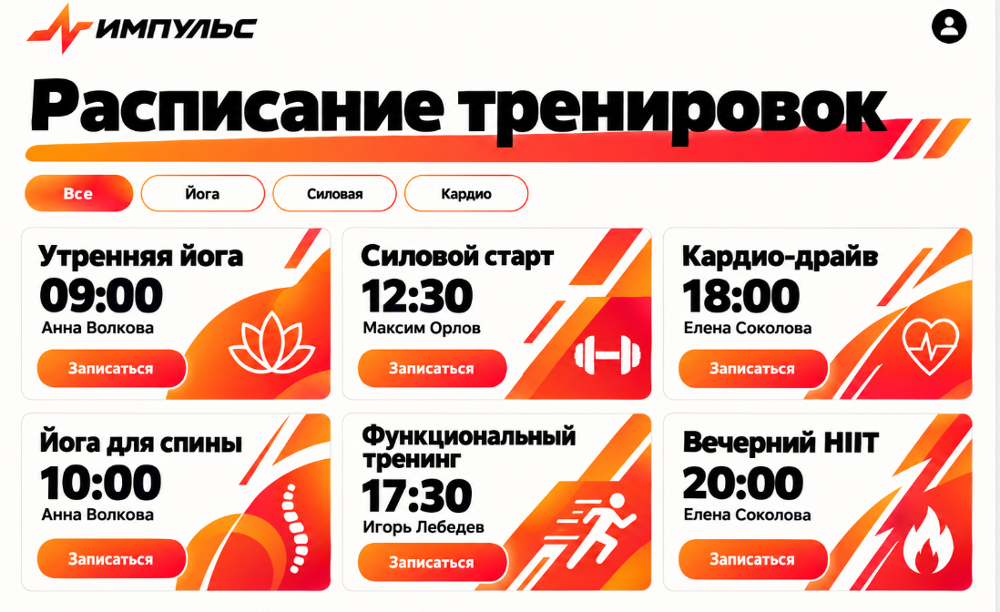

# Фитнес-клуб «ИМПУЛЬС»

Адаптивное frontend-приложение для просмотра расписания фитнес-клуба и записи на групповые тренировки. Интерфейс выполнен в яркой спортивной стилистике «ИМПУЛЬС» и рассчитан на мобильные устройства, планшеты и десктопы.

## Технологический стек

- React 18
- Vite
- Tailwind CSS
- Vitest
- React Testing Library
- JavaScript

## Установка и запуск

Для работы потребуется Node.js и npm.

```bash
npm install
```

Запуск dev-сервера:

```bash
npm run dev
```

Запуск автотестов:

```bash
npm run test
```

Создание production-сборки:

```bash
npm run build
```

## Структура проекта

```text
FitnessClubApp/
├── src/
│   ├── components/
│   │   ├── ConfirmModal.jsx
│   │   ├── FilterBar.jsx
│   │   ├── Header.jsx
│   │   ├── TrainingCard.jsx
│   │   ├── TrainingCard.test.jsx
│   │   ├── TrainingList.jsx
│   │   └── TrainingList.test.jsx
│   ├── data/
│   │   └── trainings.js
│   ├── test/
│   │   └── setup.js
│   ├── App.jsx
│   ├── index.css
│   └── main.jsx
├── index.html
├── package.json
├── postcss.config.js
├── tailwind.config.js
├── vite.config.js
├── reference.png
└── README.md
```

## Реализованные функции

### Расписание тренировок

- Отображение тренировок на 7 дней вперёд.
- В карточке указаны дата, время, тип, тренер, место и количество свободных мест.
- Адаптивная сетка: одна колонка на мобильных устройствах, две на планшетах и три на десктопах.
- Для заполненных тренировок отображается неактивная кнопка «Мест нет».

### Фильтрация по типу

- Фильтры «Все», «Йога», «Силовая» и «Кардио».
- Мгновенное обновление списка после выбора направления.
- Горизонтальная прокрутка фильтров на узких экранах.

### Запись на тренировку

- Кнопка «Записаться» открывает окно подтверждения.
- Запись можно подтвердить или отменить.
- После подтверждения на 3 секунды появляется уведомление об успешной записи.

## Скриншот интерфейса

Визуальный референс проекта:



## Backend

Проект использует **Supabase** как Backend-as-a-Service:

- **База данных:** PostgreSQL (в облаке Supabase)
- **Аутентификация:** Supabase Auth (email + пароль)
- **API:** автоматически генерируемый REST API Supabase
- **Безопасность:** Row Level Security (RLS) — пользователь может работать только со своими записями

### Переменные окружения

Создайте `.env.local` в корне проекта по образцу `.env.example`:

```env
VITE_SUPABASE_URL=your_supabase_url
VITE_SUPABASE_PUBLISHABLE_KEY=your_publishable_key
```

### Как развернуть Backend

1. Создайте проект на [database.new](https://database.new).
2. Выполните SQL из `supabase/migrations/001_init.sql` в SQL Editor.
3. Включите Email/Password provider в Authentication → Sign In / Providers.
4. Отключите Confirm email для тестирования.
5. Настройте URL Configuration: `http://localhost:5174`.

Полная документация: [backend_documentation.md](./backend_documentation.md).

## Развёртывание

1. **Клонировать репозиторий:**
   git clone <url>
   cd FitnessClubApp

2. **Установить зависимости:**
   npm install

3. **Настроить Supabase:**
   - Создать проект на database.new
   - Выполнить SQL из supabase/migrations/001_init.sql
   - Включить Email/Password в Authentication
   - Скопировать Project URL и Publishable key

4. **Создать .env.local:**
   VITE_SUPABASE_URL=ваш_url
   VITE_SUPABASE_ANON_KEY=ваш_ключ

5. **Запустить:**
   npm run dev

Подробно — в [backend_documentation.md](./backend_documentation.md)


### Реализованные функции

- Просмотр расписания тренировок из БД
- Фильтрация по типу
- Регистрация и вход через Supabase Auth
- Запись на тренировку с сохранением в БД
- RLS: пользователь может просматривать и изменять только свои записи
